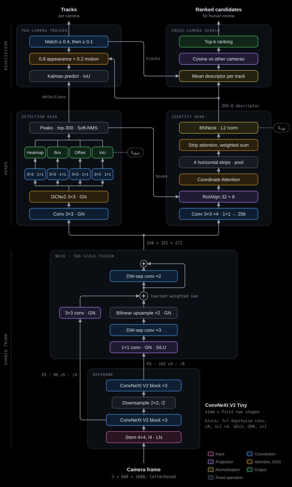

# Architecture

How EffiPed is built, trained and run, and where each part lives in this repository.
Every number below comes from [`configs/system/effiped.yaml`](configs/system/effiped.yaml)
and the code under [`src/effiped`](src/effiped). The website's Architecture tab shows the
same material, and a unit test fails if the values it prints drift from the configuration.



## The pipeline in one paragraph

A camera frame is letterboxed to 1088 × 608 and passed through one network. The stem and
first two stages of ConvNeXt V2 Tiny produce features at stride 4 (P2) and stride 8 (P3).
A small neck fuses them into one 256-channel map at stride 4. Two heads read that map: a
CenterNet-style detection head that finds people, and an identity head that turns each
detected box into a 256-dimensional appearance descriptor built from four body strips. A
tracker links detections over time within each camera. Search then compares people
across cameras by their descriptors and ranks candidates for a person to review. A ranked
candidate is never treated as an identification.

## Model

7.78 million parameters in total, one forward pass per frame.

| Part | What it does | Output |
|---|---|---|
| Backbone | ConvNeXt V2 Tiny, stem and first two stages only (`use_bifpn: false`). Each block: 7×7 depthwise conv, LayerNorm, 1×1 expand ×4, GELU, GRN, 1×1 project. | P2 96 × 152 × 272, P3 192 × 76 × 136 |
| Neck | P3: 1×1 conv to 256, GroupNorm, SiLU, three depthwise-separable convs, bilinear 2× upsample, GroupNorm. P2: 3×3 conv to 256, GroupNorm. A learned, softplus-normalised weighted sum joins them, then two depthwise-separable convs refine the result with a residual connection. | 256 × 152 × 272 |
| Detection head | Shared 3×3 conv then a 3×3 deformable conv (DCNv2), GroupNorm throughout. Four branches, each 3×3 conv then 1×1: centre heatmap, box as left/top/right/bottom distances, sub-pixel centre offset, and predicted IoU. | 1 + 4 + 2 + 1 maps at stride 4 |
| Identity head | Its own branch of four 3×3 convs and a 1×1 projection gives a 256-channel embedding map. For each box: RoIAlign to 32 × 8, Coordinate Attention, split into four horizontal strips (head to legs), average-pool each strip, weight the strips with a softmax attention, sum, BNNeck, L2-normalise. | 256-D descriptor per person |

Code: [`model.py`](src/effiped/model.py) assembles
[`models/backbone.py`](src/effiped/models/backbone.py),
[`models/fusion.py`](src/effiped/models/fusion.py) and
[`models/head.py`](src/effiped/models/head.py).

## Training

### Objective

Detection and identity are balanced by learned task uncertainties (Kendall et al.; the
FairMOT form), so neither has to be hand-weighted against the other:

```text
L = ½ · [ exp(−s_det) · L_det + s_det + exp(−s_id) · L_id + s_id ]
```

`s_det` and `s_id` are trained with the network, starting at −1.85 and −1.05.

| L_det term | Loss | Weight |
|---|---|---:|
| Heatmap | Gaussian focal loss (α 2, β 4); positives with low visibility weighted up to 1.5× | 1.0 |
| Box size | GIoU on the four box distances, at every pixel inside the centre Gaussian (≥ 0.3), weighted by that Gaussian | 0.5 |
| Centre offset | L1 on the sub-pixel offset | 1.0 |
| Repulsion | Smooth L1 on predicted overlap with the nearest neighbour beyond their true overlap | 0.4 |
| Box quality | Binary cross-entropy between predicted and actual IoU | 1.0 |

| L_id term | Loss | Weight |
|---|---|---:|
| Identity | ArcFace (scale 16, margin 0.25) on the descriptor after BNNeck, label smoothing 0.1, dropout 0.1, weighted by visibility | 1.0 |
| Strip identity | ArcFace on each of the four strip descriptors, one classifier per strip | 0.3 |
| Metric | Batch-hard triplet (margin 0.5) on the descriptor before BNNeck, mined against an 8,192-entry cross-batch memory | 0.3 |
| Strip metric | Batch-hard triplet on each strip within the batch | 0.09 |
| Strip diversity | Penalises similarity between one person's strip descriptors | 0.1 |

Identity targets sit on the centre pixel of each box; box targets are spread over the
centre Gaussian. BNNeck separates the two identity spaces: triplet losses see the
descriptor before it, ArcFace after it. All of this is in [`loss.py`](src/effiped/loss.py)
(`CenterNetLoss`).

### Data and schedule

| | |
|---|---|
| Data | P-DESTRE, MOT17, MOT20 and SOMPT22 sequences, with CrowdHuman mixed in at 12% |
| Sampling | Identity-aware batches that pair distant frames of the same people, plus 50% extra cross-camera batches; one frame in three; boxes at least 30% visible |
| Augmentation | Colour jitter, random erasing, mosaic and mixup, blur, noise, grayscale, and surveillance degradations (JPEG quality 30–70, 0.25–0.5× resolution, gamma) |
| Optimiser | AdamW, learning rate 1e-4, weight decay 0.01; the pretrained backbone stages at 0.1× |
| Schedule | 15 epochs, linear warm-up over the first 1,000 batches, cosine warm restarts (T₀ 5, ×2) |
| Batch | 2 images, gradients accumulated over 8 steps, clipped at norm 10 |

Code: [`train.py`](src/effiped/train.py), [`dataset.py`](src/effiped/dataset.py). Dataset
paths in the configuration are placeholders; the data is not distributed here.

## Inference

1. **Decode.** Take 3×3 max-pool peaks of the heatmap, keep the top 300, score each as
   √(heatmap × predicted IoU), and suppress duplicates with Gaussian Soft-NMS (σ 0.35).
2. **Describe.** Pool every kept box from the embedding map into its 256-D descriptor.
3. **Track within a camera** ([`tracking/unified_tracker.py`](src/effiped/tracking/unified_tracker.py)).
   A Kalman filter predicts each track. Detections scoring at least 0.4 are matched first
   on a cost that is 0.8 appearance and 0.2 motion; leftovers and detections down to 0.1
   are then matched on box overlap. Appearance compares the track's running descriptor
   (0.6 of the cost) and its strips weighted by how visible each is in both (0.4), and
   also checks a memory of earlier looks. Lost tracks are kept for 30 frames.
4. **Search across cameras** ([`apps/api/person_search_service.py`](apps/api/person_search_service.py)).
   Each track becomes a person with the mean of its descriptors. Short same-camera
   fragments with very similar descriptors are merged. A person's candidates are the
   people in other clips, ranked by cosine similarity.

The configuration also describes a bounded cross-camera gallery
([`tracking/cross_camera_associator.py`](src/effiped/tracking/cross_camera_associator.py)),
with time windows and transition weights. It is tested on its own; the API does not use it.

## Repository map

| Path | What it is |
|---|---|
| [`src/effiped/`](src/effiped) | The installable package: model, losses, training, tracking and the inference runtime ([`runtime.py`](src/effiped/runtime.py)). Entry points are in [`cli.py`](src/effiped/cli.py). |
| [`apps/api/`](apps/api) | Local FastAPI service that runs the model on uploaded videos. Needs authorised weights. |
| [`apps/web/`](apps/web) | The browser console (React, Vite). It replays saved results and runs no model. |
| [`configs/system/effiped.yaml`](configs/system/effiped.yaml) | The one configuration for model, data, losses, training and tracking. |
| [`research/results/summary.json`](research/results/summary.json) | Every published number, in one file. |
| [`research/report/`](research/report) | Generator for the technical report PDF. |
| [`docs/`](docs) | Served as the website's static files: demo media, diagram, report, favicon. |
| [`tools/`](tools) | Validators for results, media and release hygiene, and the offline builders for demo data and the diagram. |
| [`tests/`](tests) | Python tests for the API, the model, the tracker and the evidence. |

## How the browser demo works

The hosted site runs no model. Two files, built offline with a research version of
EffiPed and checked in, hold everything it shows:

- [`apps/web/src/data/person-search.json`](apps/web/src/data/person-search.json): the
  people found in the four demo clips, their appearances, and the ranked candidates.
- [`apps/web/src/data/frame-detections.json`](apps/web/src/data/frame-detections.json):
  every detection on each processed frame, with its track id.

[`apps/web/src/engine/pipeline.ts`](apps/web/src/engine/pipeline.ts) re-applies the
threshold settings to those records, so moving a slider changes what survives. It cannot
create a detection the model never made. Full frames are redrawn by seeking the shipped
clip and drawing the stored boxes.

## Where the numbers come from

[`research/results/summary.json`](research/results/summary.json) is the only place a
published number is written. README, RESULTS, the model card, the report and the website
read it or are checked against it by
[`tools/validate_results.py`](tools/validate_results.py). The measurements were made
outside this repository and cannot be reproduced from it, because the weights are not
public; see [RESULTS.md](RESULTS.md) and [DATA_LICENSES.md](DATA_LICENSES.md).

## Rebuilding generated files

| File | Command |
|---|---|
| Architecture diagram | `python tools/architecture/build_diagram.py`, then `node tools/architecture/export_png.mjs` |
| Technical report | `pip install -e ".[report]"`, then `python research/report/generate_report.py` |
| Media manifest | `python tools/build_session3_manifest.py` |
| Demo data | `tools/build_person_search_fixture.py` and `tools/build_detection_fixture.py` (need the research checkout, clips and a checkpoint) |
