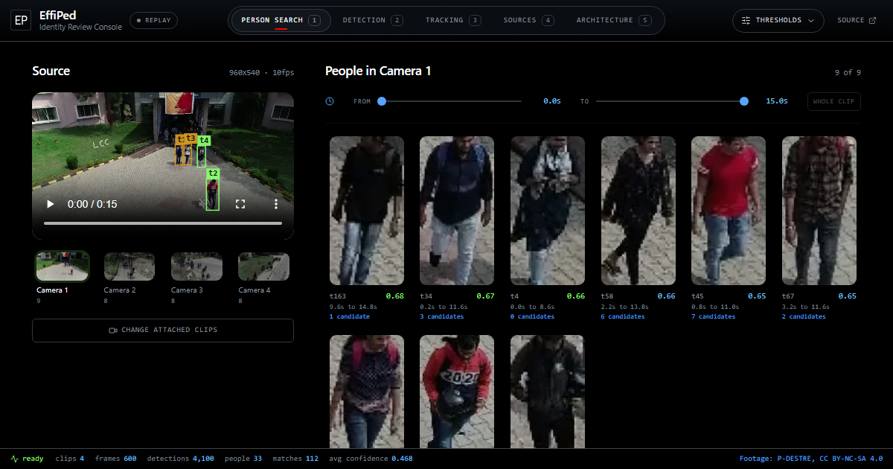

# EffiPed

EffiPed finds people in video, follows them within each camera, and suggests similar-looking
people in other cameras for a human to review. One compact network (7.78M parameters) does
both the detection and the appearance description.

By [Aswanth Raj](https://github.com/aswanth-07).

[](LICENSE)
[](docs/media/LICENSE.md)



## Try the demo

[Open EffiPed](https://effiped-multi-camera-tracking.vercel.app). Four camera clips are
already loaded. Switch tabs with the number keys:

- **Person Search** (`1`): choose a camera and a person, then review matches from the other
  cameras beside the full video frame each one came from. The source clip plays with the
  tracked boxes drawn on it, and picking a person stops it on them.
- **Detection** (`2`): every person the detector found in a frame.
- **Tracking** (`3`): a clip playing with its tracks drawn on it; open any track in Person Search.
- **Sources** (`4`): the attached clips.
- **Architecture** (`5`): the model diagram, every training loss and its weight, and the
  training and inference settings.

**Thresholds** in the top bar filters the saved detections, people and matches together,
and the status bar shows how the counts change. The site shows results saved from a research
version of EffiPed; it runs no model and uploads nothing. The scores reported below come
from the part-based model described in [ARCHITECTURE.md](ARCHITECTURE.md), not from the demo.

Run the website locally:

```bash
cd apps/web
npm install
npm run dev
```

## How it works

[](ARCHITECTURE.md)

The stem and first two stages of ConvNeXt V2 Tiny feed a two-scale neck that fuses stride-4
and stride-8 features. A CenterNet-style head detects people; an identity head pools each
box with RoIAlign, applies Coordinate Attention and combines four body strips into a 256-D
descriptor. A tracker follows people within each camera using motion, box overlap and
appearance, and search ranks people in other cameras by cosine similarity.

[ARCHITECTURE.md](ARCHITECTURE.md) gives the layers, the training losses and their weights,
the training schedule, the inference steps and a map of the code. The diagram is drawn by
[`tools/architecture/build_diagram.py`](tools/architecture/build_diagram.py).

## Reported results

| Evaluation | Result |
|---|---:|
| P-DESTRE validation cross-camera Rank-1 | 62.8% |
| P-DESTRE test cross-camera Rank-1 | 61.3% |
| P-DESTRE validation / test detection mAP@0.5 | 90.74% / 88.4% |
| MOT17 validation half MOTA / IDF1 / HOTA | 64.08 / 74.24 / 61.34 |
| Model size and full-pipeline speed | 7.78M parameters / approximately 18 FPS |

Rank-1 is how often the correct person is the first candidate. The other scores measure
detection and tracking quality; [RESULTS.md](RESULTS.md) explains each one and its
conditions. Speed was measured at 1088 × 608 on an NVIDIA RTX 5080 Laptop GPU.

These are archived measurements recorded in [the results file](research/results/summary.json).
The weights and raw evaluation records are not public, so this repository cannot reproduce
them, and no repeated-run variation, confidence intervals or significance tests are reported.

## Run the model locally

Python 3.11 or newer and an NVIDIA GPU are recommended. You need an authorised checkpoint:
public weights are withheld while training-data redistribution terms are reviewed
([DATA_LICENSES.md](DATA_LICENSES.md)).

```bash
python -m venv .venv
# Windows: .venv\Scripts\activate
# Linux/macOS: source .venv/bin/activate
pip install -e ".[runtime]"
effiped-app
```

`effiped-app` starts the local inference service. Put `effiped-v1.pt` in
`EFFIPED_WEIGHTS_DIR`; without it the service still starts and reports the model as
unavailable. The other commands:

| Command | What it does |
|---|---|
| `effiped-train --config configs/system/effiped.yaml` | Trains the model (needs the datasets) |
| `effiped-eval --config configs/system/effiped.yaml` | Checks the archived results against [the results file](research/results/summary.json) |
| `effiped-demo` | Starts the browser demo from `apps/web` |

| Variable | Purpose |
|---|---|
| `EFFIPED_WEIGHTS_DIR` | Directory containing authorised model weights |
| `EFFIPED_RUNTIME_DIR` | Temporary uploads, crops, and job assets |
| `EFFIPED_DEVICE` | `auto`, `cpu`, `cuda`, or `cuda:N` |
| `EFFIPED_MAX_UPLOAD_MB` | Upload limit for each video |
| `EFFIPED_ALLOWED_ORIGINS` | Comma-separated list of allowed browser origins |

### API

- `GET /api/health`
- `GET /api/models`
- `POST /api/person-search/jobs` with model key `effiped`
- `GET /api/person-search/jobs/{job_id}` and `/stream`
- `GET .../people`, `/detections`, `/tracks`, and `/matches`
- `POST .../search-by-example`
- `DELETE /api/person-search/jobs/{job_id}`
- `GET /api/assets/{asset_id}`

Deleting a job removes its uploaded video and generated assets.

## Repository layout

```text
src/effiped/              model, losses, training, tracking, inference runtime
apps/api/                 local inference service (FastAPI)
apps/web/                 browser demo (React, Vite); replays saved results
configs/system/           the EffiPed configuration
research/results/         every published number, in one file
research/report/          technical report and its generator
docs/                     static files the website serves: media, diagram, report
tools/                    validators, demo-data builders, diagram generator
tests/                    Python tests
```

[ARCHITECTURE.md](ARCHITECTURE.md#repository-map) explains each part, and
[CONTRIBUTING.md](CONTRIBUTING.md) lists the checks to run before a change.

## Limitations

- Similarity ranks candidates; it does not prove identity. Scores are not calibrated
  probabilities, and visually different people can receive very close scores.
- The measurements cover the recorded P-DESTRE splits and the MOT17 validation half. They
  do not establish performance at another site, for another population, or on another
  camera network.
- No fairness analysis or study of reviewer speed and accuracy is included.
- The local API ranks across cameras by cosine similarity alone. The `cross_camera:`
  settings in [the configuration](configs/system/effiped.yaml) belong to
  `CrossCameraAssociator`, which is tested separately and is not connected to the API.
- The API has no authentication and binds to `127.0.0.1` by default. The container binds
  to `0.0.0.0`; exposing its port requires access controls.
- `train.py`, `loss.py` and `dataset.py` are research code excluded from Ruff, and
  inference cannot be tested end to end without a checkpoint.

## License and use

Original software is © 2026 Aswanth Raj and licensed under Apache-2.0. P-DESTRE-derived
clips and crops have a separate [CC BY-NC-SA 4.0 media license](docs/media/LICENSE.md);
their [asset manifest](docs/media/ASSET_MANIFEST.json) records attribution,
transformations, purpose and hashes.

This release is for non-commercial research and education with human review. It includes
demonstration media, but no raw dataset, original source videos, person-level benchmark
records, checkpoints, or assets produced by local inference jobs.

[Architecture](ARCHITECTURE.md) · [Results](RESULTS.md) · [Model card](MODEL_CARD.md) ·
[Data and weight-release audit](DATA_LICENSES.md) · [Third-party notices](THIRD_PARTY_NOTICES.md) ·
[Contributor checks](CONTRIBUTING.md) · [P-DESTRE paper](https://arxiv.org/abs/2004.02782)
